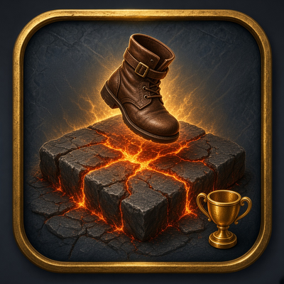
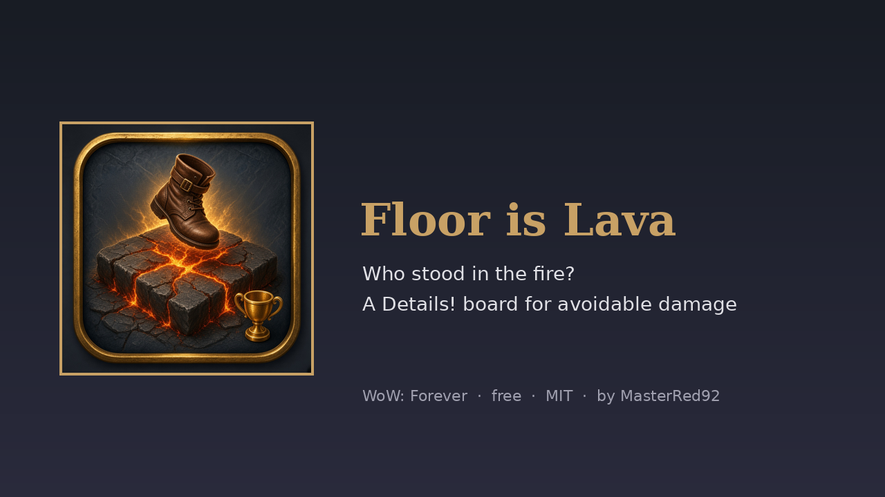
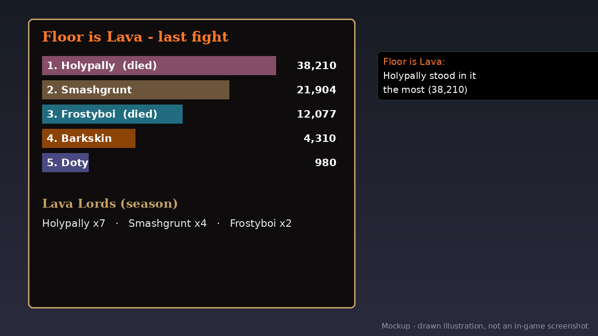

# Floor is Lava (WoW: Forever) v1.0.1

   

Somebody always stands in the fire. **Floor is Lava** shows who, after every group fight.

- **The board:** avoidable damage taken and deaths for the last fight, read from the game's own damage meter data, ranked with class colours. Open it from its button on the Details! toolbar or with `/lava`.
- **Lava Lords:** a season tally of who topped the board most often, kept until you reset it.
- **Champion line:** after each group fight, a line in *your* chat names the top lava-stander. Only you see it.
- **`/lava report`:** posts the top 3 to party or raid, only when you type it.
- Group fights only by default (`/lava solo` to count solo fights too). It never posts on its own and doesn't send addon messages.

**Needs:** Required: [Details! Damage Meter](https://www.curseforge.com/wow/addons/details). The numbers come from the game's own damage meter data (C_DamageMeter).

**Works with:** Uses the Forever client's built-in damage meter, so it works alongside Details! or any other meter.

## Download
- **Wago Addons:** coming at launch (Nov 4). The link goes here when the project is live.
- **CurseForge:** maybe later.
- **GitHub:** [Releases](https://github.com/masterred92/FloorIsLava/releases) (from the first tagged release) · [Issues](https://github.com/masterred92/FloorIsLava/issues)
- **More by Kenny:** [BRBoss](https://github.com/masterred92/BRBoss) · [WipeAndWin](https://github.com/masterred92/WipeAndWin) · [all WoW: Forever addons](https://github.com/masterred92/wow-forever-addons)

## Commands
`/lava` board · `/lava report` · `/lava solo` · `/lava quiet` · `/lava reset`

## Install
Put the `FloorIsLava` folder in `World of Warcraft\_forever_\Interface\AddOns\` and restart the game or `/reload`.

## In-game test checklist (launch day)
1. Details! shows a Floor is Lava button on its toolbar, and the icon is in the AddOns list.
2. Do a dungeon pull in a group, take some avoidable damage, and leave combat: within 2 s a champion line prints and `/lava` shows the board.
3. If the board stays empty after fights where people clearly stood in fire, the Forever client's avoidable-damage data may not be filled in. Run `/lava solo` and test again, then report it.
4. `/lava report` posts the top 3 to party.
5. `/reload` keeps the tally.

## Licence
MIT. Written from scratch; no code copied from other addons. Free, no paid features. It doesn't automate gameplay: everything it does is a reaction you can see or something you typed.

## Development
`tests/run.sh [path-to-wow-ui-source-forever]` runs `luac -p`, luacheck, the mock-client tests and (with a path) an API check against Blizzard's Forever UI source and the host addons' source. GitHub Actions runs the tests on every push. The release workflow is a manual dry run that builds the zip with [BigWigsMods/packager](https://github.com/BigWigsMods/packager); publishing is switched off until the Wago project ID is added (see the comments in `.github/workflows/release.yml`).
